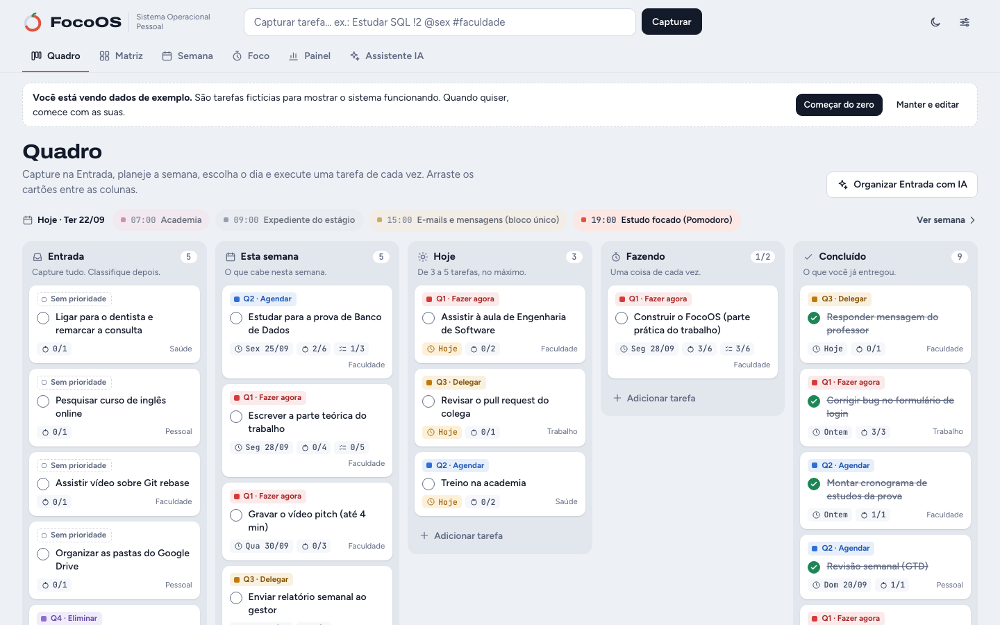
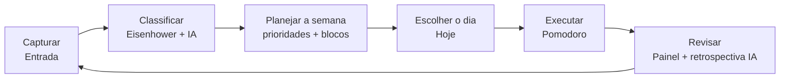
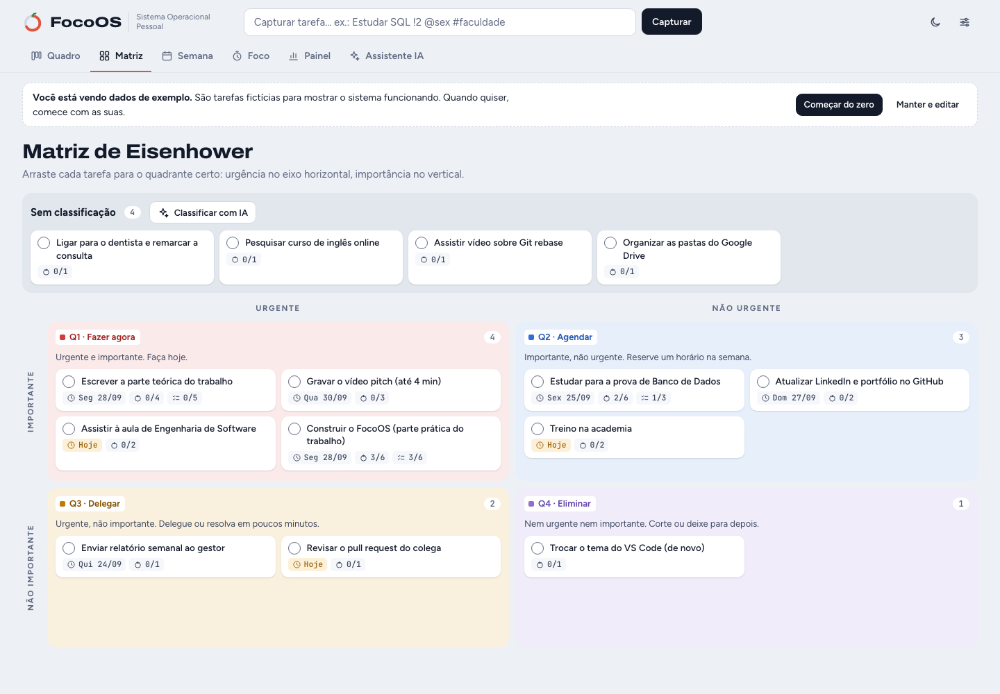
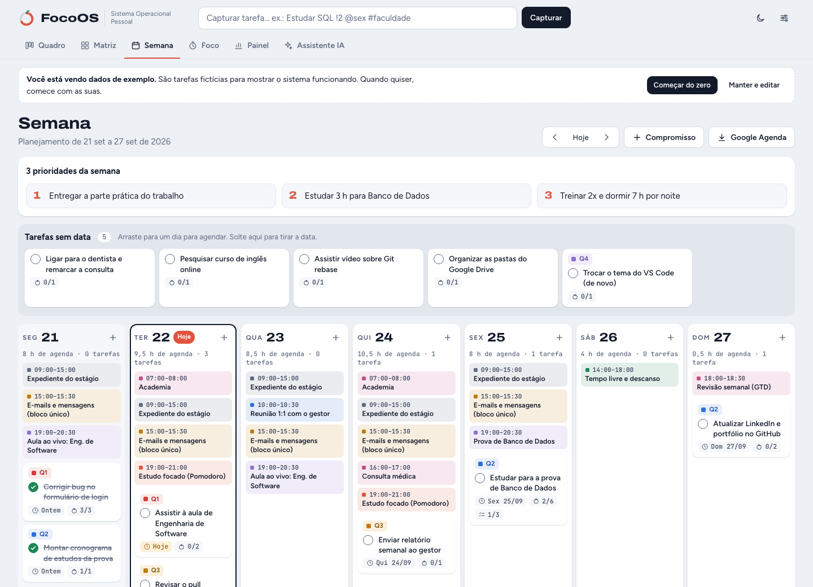
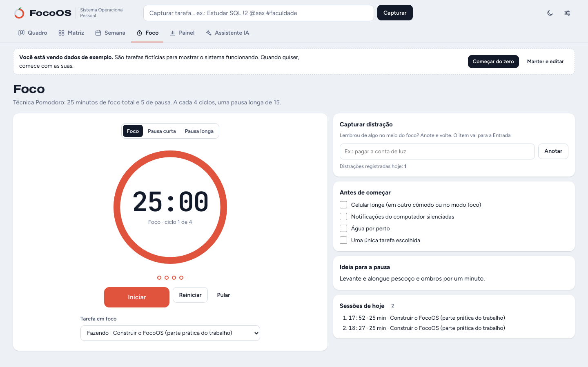
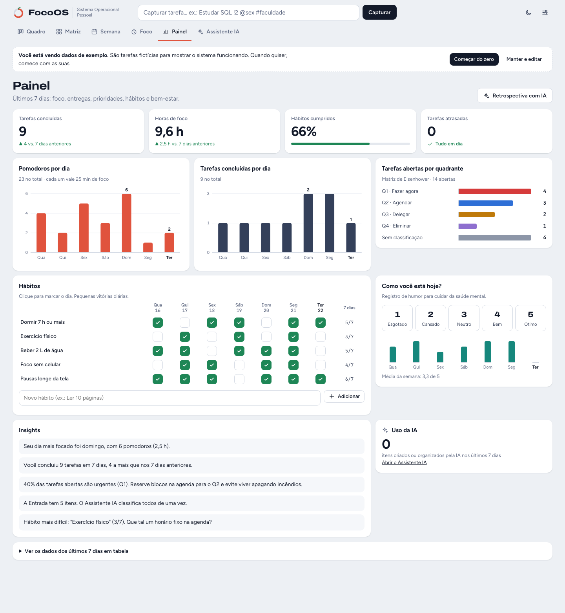
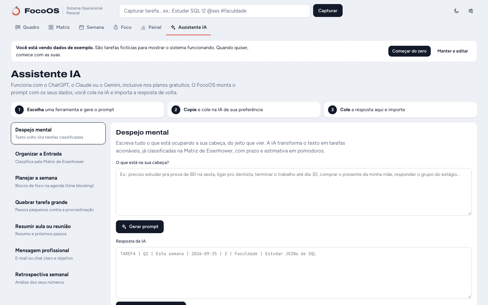
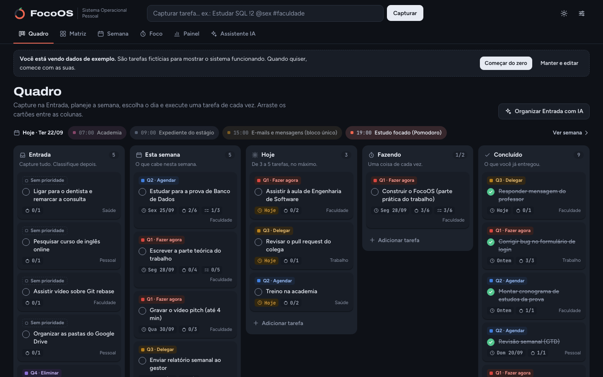
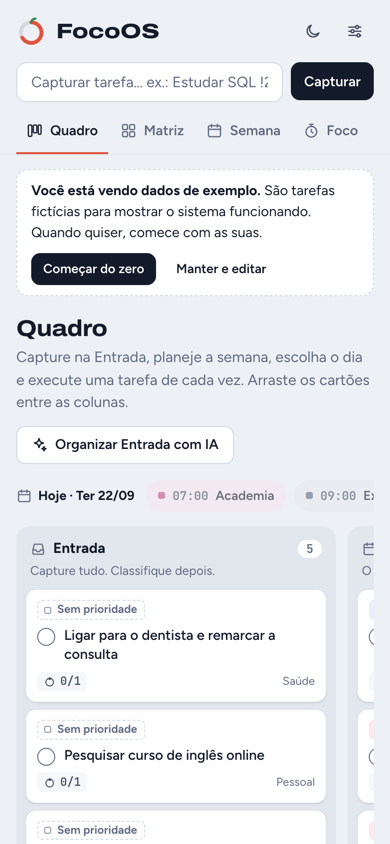

# FocoOS: meu Sistema Operacional Pessoal

> Parte prática do trabalho **"Meu Sistema Operacional Pessoal: Utilizando IA para Gerenciar Tempo, Comunicação e Produtividade"**, disciplina **Produtividade e Gestão do Tempo** (UniFECAF).
>
> **Aluno:** Lucas Mari Dreyer · **Curso:** Graduação em Inteligência Artificial e Automação Digital

**Acesse o sistema:** [lucasdreyer.github.io/focoos](https://lucasdreyer.github.io/focoos/)



## Descrição do sistema

O **FocoOS** reúne num só lugar tudo o que eu preciso para organizar a rotina de estudos, trabalho e vida pessoal:

- **Quadro Kanban** com o fluxo do método **GTD**: tudo é capturado na *Entrada*, planejado para *Esta semana*, escolhido para *Hoje*, executado em *Fazendo* e registrado em *Concluído*. A coluna *Fazendo* tem **limite WIP** (padrão: 2 tarefas), para evitar o multitarefa.
- **Matriz de Eisenhower** interativa: arraste cada tarefa para Q1 (fazer agora), Q2 (agendar), Q3 (delegar) ou Q4 (eliminar).
- **Planejamento semanal** com as 3 prioridades da semana, compromissos (aulas, estágio, reuniões, descanso) com repetição semanal e tarefas arrastáveis para os dias (**time blocking**).
- **Timer Pomodoro** ligado às tarefas: conta os pomodoros de cada uma, alterna foco e pausas, tem checklist de preparação e um campo para **capturar distrações** sem perder o foco.
- **Painel de produtividade** com indicadores dos últimos 7 dias, gráficos, rastreador de **hábitos**, registro de **humor** (saúde mental) e insights automáticos.
- **Assistente de IA** com 7 ferramentas que funcionam com o ChatGPT, o Claude ou o Gemini, sem chave de API: o FocoOS monta o prompt com os meus dados, eu colo na IA e **importo a resposta de volta** (tarefas, blocos na agenda, checklists).

É uma aplicação web feita com **HTML, CSS e JavaScript puro**, sem frameworks e sem servidor. Os dados ficam salvos no próprio navegador. Desenvolvi o FocoOS com o **Claude Code**, assistente de programação com IA.

## Como o FocoOS atende aos requisitos

| Requisito da parte prática | Onde está no FocoOS |
|---|---|
| Organização de tarefas e prioridades | Aba **Quadro** (Kanban + GTD) e aba **Matriz** (Eisenhower) |
| Planejamento semanal ou mensal | Aba **Semana**: 3 prioridades, compromissos, tarefas arrastadas para os dias |
| Gestão de compromissos | Compromissos únicos ou semanais, agenda do dia no Quadro e exportação da agenda em arquivo `.ics` |
| Pelo menos uma técnica de produtividade | **Pomodoro**, **Matriz de Eisenhower**, **GTD**, **Kanban com limite WIP** e **time blocking** |
| Pelo menos uma ferramenta digital | O próprio FocoOS (aplicação web no estilo Trello), usado junto com o **ChatGPT** e o **Claude** |
| IA para automatizar, resumir, organizar ou planejar | Aba **Assistente IA**: despejo mental, organizar a Entrada, planejar a semana, quebrar tarefas, resumir aulas e reuniões, escrever mensagens, retrospectiva |
| Dashboard de acompanhamento | Aba **Painel**: indicadores, gráficos, hábitos, humor, insights e uso da IA |

## Ferramentas utilizadas

| Ferramenta | Para quê |
|---|---|
| **HTML5, CSS3 e JavaScript** | Interface e lógica do sistema, sem bibliotecas externas |
| **localStorage** do navegador | Salvar os dados sem precisar de servidor ou cadastro |
| **ChatGPT** e **Claude** | Classificar, planejar, resumir e escrever (via Assistente IA) |
| **Claude Code** | Assistente de programação com IA usado para desenvolver o FocoOS |
| **GitHub** e **GitHub Pages** | Versionamento do código e publicação do site |

## Fluxo de organização



**Todo dia (cerca de 10 minutos)**
1. De manhã, reviso a agenda do dia no topo do Quadro e escolho de 3 a 5 tarefas para **Hoje**.
2. Puxo uma tarefa para **Fazendo** e trabalho em ciclos de **Pomodoro** (25 min de foco e 5 de pausa).
3. Ideias e lembretes que aparecem no meio do foco vão para a **Entrada** pelo campo "Capturar distração".
4. Respondo e-mails e mensagens só nos **blocos de comunicação** (10h, 14h30 e 21h), e não o dia inteiro.
5. À noite, marco os **hábitos** e o **humor** do dia no Painel.

**Toda semana (domingo, cerca de 30 minutos)**
1. Uso a IA para **organizar a Entrada** e classificar tudo na Matriz de Eisenhower.
2. Defino as **3 prioridades da semana** e peço à IA para **planejar a semana** em blocos de foco.
3. Gero a **retrospectiva semanal com IA** a partir dos números do Painel.

## Prints

| Quadro Kanban (GTD) | Matriz de Eisenhower |
|---|---|
|  |  |

| Planejamento semanal | Foco (Pomodoro) |
|---|---|
|  |  |

| Painel de produtividade | Assistente IA |
|---|---|
|  |  |

| Tema escuro | Celular |
|---|---|
|  |  |

> Os prints mostram os **dados de exemplo** que vêm com o sistema.

## Como utilizar

### Abrir o sistema
1. Acesse **[lucasdreyer.github.io/focoos](https://lucasdreyer.github.io/focoos/)**, ou baixe este repositório e dê dois cliques em `index.html`. Funciona no Chrome, Edge, Firefox e Safari.
2. Na primeira vez, o FocoOS abre com **dados de exemplo**. Clique em **Começar do zero** para usar com as suas tarefas, ou em **Manter e editar**.

### Publicação
O site é publicado pelo **GitHub Pages** a partir da branch `main` (pasta `/ (root)`). Para publicar uma cópia, faça um fork e ative *Settings › Pages* no seu repositório.

### Captura rápida
Digite na barra do topo e pressione **Enter**. A tarefa vai para a Entrada. Atalhos opcionais:

| Atalho | Efeito | Exemplo |
|---|---|---|
| `!1` a `!4` | Prioridade (quadrante) | `Pagar boleto !1` |
| `@hoje`, `@amanhã`, `@sex`, `@25/09` | Prazo | `Estudar SQL @sex` |
| `#faculdade`, `#trabalho`, `#pessoal`, `#saude` | Área | `Academia #saude` |

No teclado: **N** abre a captura rápida, **1** a **6** trocam de aba e **Esc** fecha as janelas.

### Quadro e Matriz
- **Arraste** os cartões entre as colunas (ou entre os quadrantes da Matriz).
- Clique no círculo do cartão para **concluir**. Clique no cartão para editar descrição, checklist, prazo, prioridade, área e estimativa de pomodoros.
- Na coluna *Adicionar tarefa*, cole várias linhas para criar várias tarefas de uma vez.

### Semana
- Escreva as **3 prioridades da semana**.
- Use **+ Compromisso** para aulas, estágio, reuniões e descanso (com repetição semanal).
- Arraste as **tarefas sem data** para os dias. **Google Agenda** gera o arquivo `.ics`. Para importar, no Google Agenda abra *Configurações › Importar e exportar › Importar*.

### Assistente IA, passo a passo
1. Escolha uma ferramenta (por exemplo, **Despejo mental**) e clique em **Gerar prompt**.
2. Clique em **Copiar prompt**, abra o ChatGPT, o Claude ou o Gemini e cole.
3. Copie a resposta da IA, cole em **Resposta da IA** e clique em **Importar para o FocoOS**.

As tarefas, os blocos de foco e os checklists criados pela IA aparecem com o selo **IA**, e cada uso fica registrado no **Histórico de uso da IA**.

| Ferramenta | O que a IA faz | O que entra no FocoOS |
|---|---|---|
| Despejo mental | Transforma texto solto em tarefas classificadas | Tarefas |
| Organizar a Entrada | Classifica a Entrada na Matriz de Eisenhower | Prioridade, lista, prazo e estimativa |
| Planejar a semana | Monta blocos de foco sem conflitar com a agenda | Blocos na aba Semana |
| Quebrar tarefa grande | Divide em passos de até 25 minutos | Checklist da tarefa |
| Resumir aula ou reunião | Resume e extrai os próximos passos | Resumo e tarefas |
| Mensagem profissional | Escreve e-mails e mensagens claras | Texto para revisar e enviar |
| Retrospectiva semanal | Analisa os números do Painel | Texto salvo no Painel |

### Seus dados
- Tudo fica salvo **apenas no seu navegador** (localStorage). Nada é enviado para servidores.
- Em **Configurações** (ícone de controles no topo) é possível exportar e importar um **backup .json**, ajustar os tempos do Pomodoro e o limite WIP, trocar o tema e apagar os dados.
- Para a IA, só vai o texto que você mesmo copia e cola.

## Estrutura do projeto

```
focoos/
├── index.html   # estrutura da página
├── style.css    # visual (tema claro e escuro, responsivo)
├── app.js       # toda a lógica: quadro, matriz, semana, Pomodoro, painel, IA
├── prints/      # capturas de tela usadas neste README
└── README.md
```
